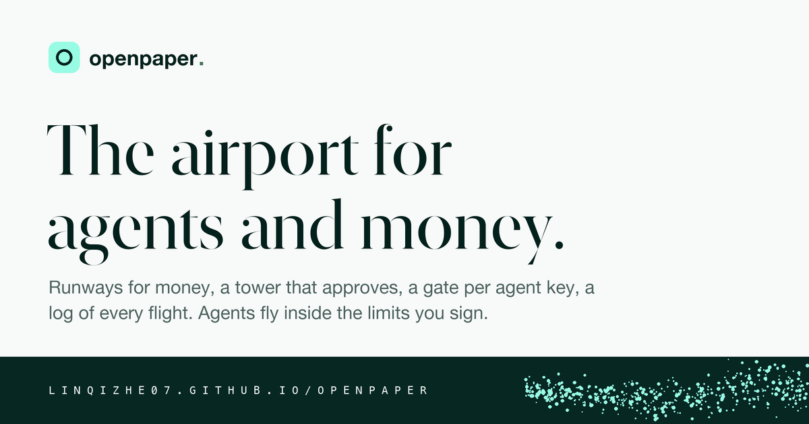
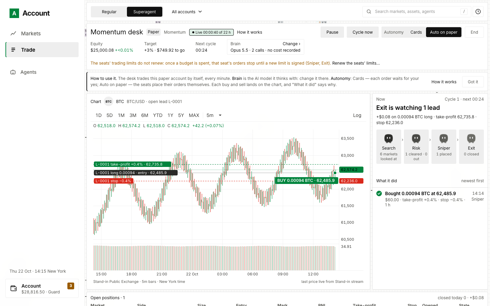

<p align="center"></p>

# openpaper

**Your trading accounts on one page, and AI agents that trade only inside the limits you sign.**

openpaper runs on your own computer. It puts your exchanges, brokers, wallets and prediction markets on one page, gives you a paper account with live prices to practise on, and lets AI agents — its own trading desk, or yours over MCP — trade, move and pay inside limits you sign. Website: [linqizhe07.github.io/openpaper](https://linqizhe07.github.io/openpaper/)

**What it does**

- **One page for your accounts.** Exchanges (93 by API key), Alpaca and Robinhood, Kalshi and Polymarket, Hyperliquid, MetaMask and other wallets: holdings, orders, positions, net worth over time, and a statement you can filter and export.
- **A paper account with live prices.** Crypto, US stocks, perpetuals and event contracts on paper money: market, limit, stop, stop-limit and trailing-stop orders, brackets, US sessions kept honestly, funding and liquidation on perpetuals.
- **Markets.** The day in six figures and the US session clock, every market at every venue that serves your network, ★ to watch and 🔔 to be told when a price crosses a line, ⌘K to search, and a US company's financials as it filed them with the SEC.
- **A trading terminal.** Its own candle chart with years of history, an order book and a trades tape fed by the venues' streams, and the account's own lines — entries, stops, resting orders — drawn on the chart.
- **The superagent.** A desk of AI agents that trades the paper account by itself and plays each step as it happens, on a key from any of thirteen model providers, or a model running on your machine.
- **Your own agent over MCP.** Thirty-five tools to read, trade, move, pay, earn, ask and remember — each inside the limit you signed for that seat.
- **You sign what matters.** Every order, movement and limit is signed by a key your browser cannot export; Guard holds each request for your yes, Beast lets agents act inside their limits; a cap on every order; a hash-chained log of everything.
- **Nothing in the middle.** No server, no account to create, no analytics: your computer reads public prices and talks to venues directly, so your own network decides what you see.

## Contents

- [The page](#the-page)
- [Start in five minutes](#start-in-five-minutes)
- [Connect your real accounts](#connect-your-real-accounts)
- [Stay in control](#stay-in-control)
- [What has and has not been tested](#what-has-and-has-not-been-tested)
- [Your network decides what you see](#your-network-decides-what-you-see)
- [Bring your own agent](#bring-your-own-agent)
- [Keep it running](#keep-it-running)
- [Look around without anything real](#look-around-without-anything-real)
- [Options and environment](#options-and-environment)
- [Project structure](#project-structure)
- [Tech stack](#tech-stack)
- [Scripts and tests](#scripts-and-tests)
- [More](#more)
- [Changelog and versions](#changelog-and-versions)
- [License](#license)

## The page

<p align="center"></p>

Trade → Superagent on the stand-in account — no network, no money, no key — as `npx tsx test/standin/ui-standin.ts --port 4821 --superagent` shows it: every venue, price and fill on it is made up, and the desk trades with a script instead of a model. A real account looks the same with your venues and a model's key.

## Start in five minutes

You need [Node.js](https://nodejs.org) 22 or newer and Git. Tested on macOS; Linux should work the same way; Windows is untested.

```bash
git clone https://github.com/linqizhe07/openpaper.git
cd openpaper
npm ci
npm run account
```

`npm ci` may warn that a few packages' install scripts were skipped (npm 11.19 and newer ask before running them): nothing here needs them, so go on. Open **http://127.0.0.1:4820** and type the pairing code the terminal printed. That browser is now the owner: everything that moves money is signed by it. `npm run account -- --help` lists every option.

Then, on the page:

1. **Start a paper account** — $10,000 of paper money, live public prices, nothing to connect.
2. **Trade** — buy or sell crypto, US stocks, perpetuals and event contracts on paper.
3. **Superagent** (Trade → Superagent) — paste an API key and press **Start the superagent**. The desk trades your paper account by itself: every trade lands on the chart, and each step it takes is played as it happens.
4. **Watch** (Markets) — the day in six figures and the US session clock at the top; ★ a market to watch it, 🔔 to be told when it crosses a price — on the page, and as a notification if you ask. Your agents read both. ⌘K or `/` searches. Open a US stock and its **Financials** are there as the company filed them with the SEC — start the account with `SEC_CONTACT` set to your email, since the SEC asks every reader to say who they are.
5. **Backtest** — try a strategy (buy and hold, a moving-average cross, momentum, a funding carry) on recorded bars through the same paper account's rules, beside buying and holding the same markets. Every run is counted, its Sharpe deflated by everything tried before it, and the latest 90 days are held out: only you look at them, by signature. Walk forward picks a strategy's numbers fold by fold; The desk plays the account's own desk over the bars, by your signature.

The superagent needs an AI model to think with. Paste a key from any of Anthropic, OpenAI, DeepSeek, Gemini, xAI, Kimi, Qwen, OpenRouter, Groq, Together or Meta — the account tells whose key it is and picks that provider's best model — or run a model on your machine with Ollama or vLLM (no key). Its calls are billed to your key.

## Connect your real accounts

**Account → Venues → Connect an account**: 93 exchanges by API key (Coinbase, Kraken, OKX, Binance and more); Alpaca and Robinhood for US stocks; Kalshi and Polymarket; Hyperliquid; MetaMask and other wallets.

- Venue API keys go in files on your computer (`~/.openpaper/`; an older `~/.buyer-agent-demo/` is still read): the page tells you where, and the key never passes through the page or the log. An AI key you paste on the page is saved in the same folder.
- Real trading is on, with a cap on every order and movement ($100 unless you start with `--live-cap`); `--read-only` turns trading off. The options are [below](#options-and-environment).

## Stay in control

- **You sign what matters.** Orders, movements and every agent's limit are signed by your browser's key; the account checks each signature.
- **Guard or Beast.** In Guard, whatever an agent asks for waits for your yes on a card. In Beast, agents act at once — but only inside the limits you signed.
- **A cap on every order and movement.** The server starts with `--live-cap` ($100 unless you say otherwise). From Settings you can sign a different figure, up or down, to the cent; the signed figure is what the account holds to, and it comes back after a restart. Money leaves a venue only for a place shown to be yours.
- **A record of everything** in a hash-chained log on your computer, and a Statement you can filter and export.

## What has and has not been tested

No real key and no real wallet has ever been used in building this. Real connections and real-money writes were tested only against stand-ins: stand-in exchanges, a stand-in chain, test wallets made and thrown away, and keyless public reads of the venues' own APIs. The paper account, the market data, the agents and the signing have been exercised end to end; the last step at a real venue has not.

So, before you connect your own account: use a read-only key first. To write, start with a small cap and a small amount, and read the venue's own answer on the page before you trust the next one.

The trust boundary is your own computer. Key files are the user's alone (0600), and the page never sees their values, but any program running as you can read them — the same is true of any wallet or broker key on a computer. The owner's key lives in your browser and cannot be exported; if that browser's storage is cleared, `npm run account -- --fresh` is the way back, and it starts the account from nothing.

## Your network decides what you see

openpaper has no server in the middle, and no analytics: your computer reads public prices and talks to venues directly. So your network — your country, your IP, a company firewall — decides which venues answer.

- **It asks every venue from your network** and shows what serves you. A venue that refuses your network is marked *Not served here*, with its own regional edition where it has one (Binance.US, OKX US, Polymarket US). Nothing seen from anyone else's computer decides it.
- **It never routes around a block** — no proxies, no other hosts. To match venues' published rules to your network it asks a public location check (Polymarket's, Cloudflare's or ipapi.co's).
- **Check before you start:** `npm run account:check` prints what your network reaches, in each venue's own words. It contains no IP, place or key, so it is safe to share.

Where each price comes from, and how fresh it is:

| Market | Read from, in order | How often | Fills a paper order? |
|---|---|---|---|
| Crypto | A connected venue's own stream; else Kraken, Coinbase, OKX, Binance, Bybit public tickers, and the streams of Hyperliquid, Coinbase, Kraken and OKX | Live, within seconds | Yes, on a quote at most a second old |
| US stocks and ETFs | Robinhood real time, else Nasdaq real time; Cboe's 15-minute delayed quotes shown last and marked | Robinhood about every 15 s while a page shows the share | Only on a real-time quote, in the share's session; never on Cboe's |
| Perpetuals | Hyperliquid's public API and stream | Live | Yes, with hourly funding and liquidation at maintenance margin |
| Event contracts | Kalshi, Polymarket and Polymarket US public books | Live | Yes, settled at $1 or $0 when the venue says |
| Pre-IPO and RWAs | Nine venues' public tickers; Robinhood Stock Tokens, xStocks at Gate, Ondo | On each read | Pre-IPO on paper; tokenized assets through your wallet |
| Financials | SEC EDGAR, with `SEC_CONTACT` as the reader's name | Kept 12 hours | — |
| Price alerts | The market's source above | Judged every 30 s while the account runs, page open or not | — |

Where no source answers, that market has no price: a paper market order is refused and a limit order waits, and the page says why.

## Bring your own agent

Press **Copy setup command** (Portfolio's *Get started*, or under Agents) and run it where your agent lives (Claude Code or any MCP client). Let the agent in from the page and give it a limit: it can read your accounts and trade, move or pay inside that limit.

## Keep it running

On macOS:

```bash
npm run account:service -- install --live-cap 20
```

It starts when you log in and restarts if it stops. Also `status`, `restart` (after an update: `git pull`, then restart), `logs`, `code` (the pairing code) and `uninstall`. The service carries `BUYER_HOME`, `SEC_CONTACT`, the `PORTFOLIO_RPC_*` endpoints and the MetaMask switches from the shell that runs `install`, and nothing else: a model key belongs in a key file (the page writes one when you paste a key), not in the shell. On Linux, run `npm run account` under your own service manager for now; on Windows, in a terminal.

## Look around without anything real

```bash
npx tsx test/standin/ui-standin.ts --port 4821 --superagent
```

The same page with stand-in venues at http://127.0.0.1:4821 — no network, no money, no key — and a desk that trades with a script, so you can watch the superagent work before you bring a key. Its Backtest tab runs on made-up history. Use `--no-desk` instead to go through the setup yourself.

## Options and environment

`npm run account -- …` takes these; `--help` prints the same list, and a misspelt option is refused, never ignored.

| Option | What it does | Default |
|---|---|---|
| `--port <number>` | The port the page and the API listen on, on 127.0.0.1 only | 4820 |
| `--home <dir>` | The home directory: ledgers, key files, paper books, seats | `$OPENPAPER_HOME` (or `$BUYER_HOME`), else `~/.openpaper`; an older `~/.buyer-agent-demo` is still read |
| `--live-cap <dollars>` | The most one order or movement may be worth when the server starts; from Settings the owner signs another figure, which a restart keeps | 100 |
| `--read-only` | Place no order and move no money: the account reads only | off |
| `--fresh` | Start the account from nothing instead of continuing its earlier runs | off |
| `--classic` | The original simulated statement, without the account layer (`--mm` there reads the real `mm` CLI) | off |

`npm run account:check -- …` takes `--keys` (also open each connection whose key file is in the home, read-only), `--home <dir>` and `--json`. `npm run account:service -- <command>` takes `install` (followed by the server's options), `status`, `restart`, `logs`, `code`, `uninstall` and `help`.

The environment variables the account reads, and whether `account:service install` carries them into the background service:

| Variable | What it does | Read by | Travels with the service? |
|---|---|---|---|
| `OPENPAPER_HOME` | The home directory when `--home` is not given (the new name) | `home.ts` | Yes |
| `BUYER_HOME` | The home directory when neither `--home` nor `OPENPAPER_HOME` is given (the older name, still read) | `home.ts` | Yes |
| `SEC_CONTACT` | Your email address: the SEC asks every EDGAR reader to send one; without it a US share's Financials are off | `live/edgar.ts` | Yes |
| `PORTFOLIO_RPC_ETHEREUM`, `…_OPTIMISM`, `…_BNB`, `…_POLYGON`, `…_BASE`, `…_ARBITRUM`, `…_ROBINHOOD` | Your own RPC endpoint per chain | `live/chain.ts` | Yes |
| `PORTFOLIO_MM_BIN` | The `mm` command for the MetaMask Agent Wallet | `live/metamask.ts` | Yes |
| `PORTFOLIO_MM_WRITES=1` | MetaMask's own switch for real transactions; off otherwise | `live/writes.ts` | Yes |
| `PORTFOLIO_URL` | Where an MCP seat finds the account (`http://127.0.0.1:4820`) | `mcp.ts` | — |
| `PORTFOLIO_AGENT` | The seat's name when the MCP client sends none | `mcp.ts` | — |
| `PORTFOLIO_SEAT_KEYS=sim` | Derive a seat's key from its name instead of a key file: demos and tests only | `mcp.ts` | — |
| `PORTFOLIO_MM=1` | With `--classic`: the simulated statement reads the real `mm` CLI | `server.ts` | — |
| `ANTHROPIC_API_KEY`, `ANTHROPIC_AUTH_TOKEN`, `ANTHROPIC_BASE_URL` | Claude's key or token from the shell; a base URL that is not Anthropic's own host turns the key file off | `account/brain-claude.ts` | No, on purpose |
| `OPENAI_API_KEY`, `OPENAI_BASE_URL`, `OPENAI_MODEL` | OpenAI's key, host and model from the shell, for the OpenAI preset | `account/brain-openai.ts` | No, on purpose |
| `NODE_ENV=development` | Read the page's files again on every request | `server.ts` | — |

Nothing loads a `.env` file. If you want one anyway, Node's own loader does it: `node --env-file=.env --import tsx src/portfolio/server.ts -- --live-cap 20`.

## Project structure

```
src/portfolio/         the account: server.ts (the API; every /api route in its header comment), service.ts, router.ts
  account/             the signed door (exchange.ts, sign.ts), state, restore, the desk and its brains, calendar, statement
  live/                the real venues and the public market data: exchanges, Alpaca, Robinhood, Kalshi, Polymarket, Hyperliquid,
                       wallets, prices, candles, the stream hub, EDGAR
  public/              the page: account.html and ui/*.js, plain HTML, CSS and JavaScript with no build step
  backtest/            recorded bars as a public source, the engine that steps the paper account over them, the strategies and the
                       desk over bars, the figures, the lab's holdout and trials ledger (account-backtest.ts is its command)
  mcp.ts               the MCP server an agent's seat runs (41 tools)
  account-service.ts   the background service · account-check.ts  what your network reaches · home.ts  the home directory
  adapters/, venues.ts simulated venues, for --classic and the tests only
src/core/ src/agent/   shared: the hash-chained ledger (agent/ledger.ts), refusal codes, hashing, jsonl
src/runner/ src/plugins/ src/venues/ src/contract/ src/control-room/ src/wallet/
                       the earlier demos (docs/earlier-demos.md), kept for npm run demo, control-room, wallet and their tests
fixtures/home/         the fixtures the account starts from (fixtures/home/portfolio/*.json) and the demos' seed
test/                  unit/ · attack/ (every file is a closed hole) · standin/ (the stand-in account) · e2e
site/ scripts/         the public page, and the scripts that compute its numbers
docs/ COOKBOOK.md      the long descriptions, in Chinese
```

## Tech stack

Node 22, TypeScript (strict), Express, ccxt, viem, zod, the MCP SDK and vitest. The page is plain HTML, CSS and JavaScript served as files, with no framework and no build step; its fonts are self-hosted.

## Scripts and tests

| Command | What it does |
|---|---|
| `npm run account` | The account at http://127.0.0.1:4820 (`npm run portfolio` is the same) |
| `npm run account:check` | What your network reaches, in each venue's own words; safe to paste |
| `npm run account:service -- <command>` | The account as a background service on macOS |
| `npm run account:replay -- --day 2026-10-01` | A recorded day of Hyperliquid (tardis.dev; the first of each month is free) replayed through the desk on a paper account, with a script for a brain: how the desk's mechanics fare on a real day's prices, in seconds |
| `npm run account:backtest -- --markets perp:BTC,perp:ETH` | A strategy (buy and hold, a moving-average cross, time-series momentum, a funding carry, or with `--strategy desk` the account's own desk and its seats) played over recorded bars through the paper account itself, its fills, fees, funding and liquidations by the paper account's own rules, beside a buy-and-hold. Every run is a row of a hash-chained trials ledger that deflates the next run's Sharpe, and the latest 90 days are held out: `--holdout` runs on them, `--trials` prints the ledger, `--set-holdout` moves it. `--grid fast=10,20 --folds 4` walks forward: a grid's best on each fold's past, tried on the fold (also on the page, and for agents as `portfolio_backtest_walk`). Every kept run is set beside 1,000 tries of random entries with its own exits, and `--screen RUN` sweeps a desk run's exits fast over its bars, every rule counted in the ledger (also on the page, and for agents as `portfolio_backtest_screen`) |
| `npm test` | The suite: about 180 files and 3,000 cases, among them thirty-one attack files, serial because the simulators bind fixed ports |
| `npm run typecheck` | `tsc --noEmit`, strict |
| `npm run site` · `npm run site:numbers` | Preview the public page; recompute its numbers from the repository |
| `npm run demo` · `npm run control-room` · `npm run wallet` | The earlier demos |

CI runs the type check and the suite on every push and pull request.

## More

- `npm run account -- --port 4825 --home ~/openpaper-second` runs a second, separate account; `--fresh` starts one from nothing.
- In Chinese: [docs/README.zh.md](docs/README.zh.md) (the full description), [COOKBOOK.md](COOKBOOK.md) (recipes) and [docs/account.md](docs/account.md) (how every part works).
- Questions and bugs: [GitHub issues](https://github.com/linqizhe07/openpaper/issues).

## Changelog and versions

What changed is in [CHANGELOG.md](CHANGELOG.md), one line per merged pull request. Which openpaper you run is in Settings → Version and on the first line `npm run account` prints; `GET /api/now` says it too. The latest release and `main` are supported.

## License

Apache-2.0: see [LICENSE](LICENSE). Copyright 2026 Linqi Zhe. You may use, change and redistribute it, including in something you sell, as long as the licence and notices travel with it; it comes with no warranty.

To contribute, read [CONTRIBUTING.md](CONTRIBUTING.md). A security problem goes privately, as [SECURITY.md](SECURITY.md) says, never in a public issue.

openpaper is not financial advice. Real trading is at your own risk; paper money is not real money.
