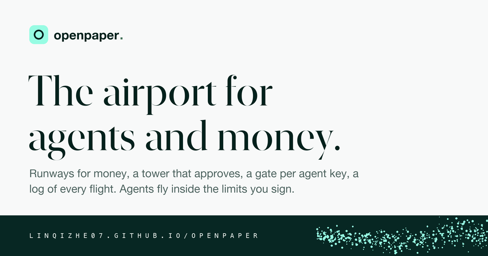
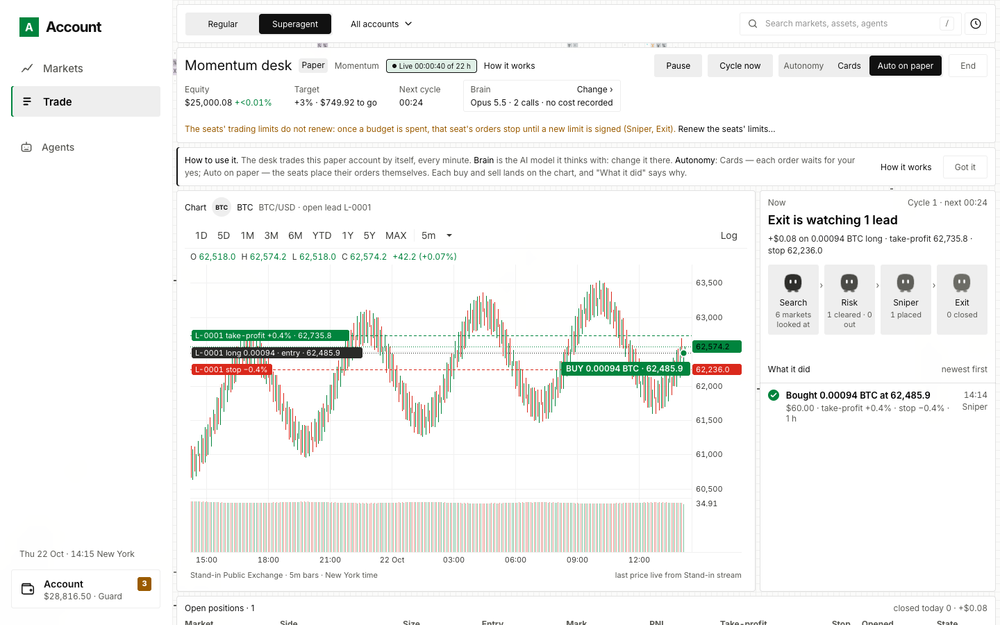

<p align="center"></p>
<p align="center"><b>English</b> · <a href="docs/README.zh.md">中文</a></p>

# openpaper

**Your trading accounts on one page, and AI agents that trade only inside the limits you sign.**

openpaper runs on your own computer. It puts your exchanges, brokers, wallets and prediction markets on one page, gives you a paper account on live prices, and lets AI agents — its own desk, or yours over MCP — trade, move and pay inside limits you sign. No server in the middle, no account to create, no analytics: your computer reads public prices and talks to the venues directly. Website: [linqizhe07.github.io/openpaper](https://linqizhe07.github.io/openpaper/)

- **Your accounts on one page.** 93 exchanges by API key, Alpaca, Robinhood, Kalshi, Polymarket, Hyperliquid, MetaMask and other wallets: holdings, orders, positions, net worth over time, a statement you can filter and export.
- **A paper account on live prices.** Crypto, US stocks, perpetuals and event contracts; market, limit, stop, stop-limit and trailing-stop orders, brackets, US sessions, funding and liquidation on perpetuals; TWAP, VWAP and iceberg execution with the transaction-cost analysis on each.
- **A terminal.** Every market your network reaches: candles with years of history, the order book and tape from the venues' streams, your own entries, stops and resting orders on the chart; ★ to watch, 🔔 to be told; a command line (⌘K: `AAPL DES`, `BTC GP`, `TOP`, `ECO`, `OMON`, `RISK`, `HELP`).
- **News, calendars, the world, options, analytics.** The publishers' own headline feeds; Nasdaq's calendars, share pages and screener; indices, the Treasury yield curve, currencies and commodities; Cboe and Deribit option chains; markets rebased, correlated and measured against each other; your own exposure, volatility, value at risk and drawdown; a Monitor of tiles you compose. Arithmetic over the venues' own figures, no forecast.
- **The world on perpetuals.** Hyperliquid's HIP-3 contracts on shares, indices, commodities, currencies and rates, charted and tradable on paper.
- **The superagent.** A desk of AI agents that trades the paper account by itself, reads the day's headlines and releases before it acts, answers your `ASK`, and plays each step as it happens — on a key from any of thirteen model providers, or a model on your machine.
- **Your own agent over MCP.** Forty-nine tools to read, trade, move, pay, earn, ask and remember, each inside the limit you signed for its seat.
- **You sign what matters.** Every order, movement and limit is signed by a key your browser cannot export; Guard holds each request for your yes, Beast lets agents act inside their limits; a cap on every order; a hash-chained log of everything.

## Contents

- [The page](#the-page)
- [Start in five minutes](#start-in-five-minutes)
- [Connect your real accounts](#connect-your-real-accounts)
- [Stay in control](#stay-in-control)
- [What has and has not been tested](#what-has-and-has-not-been-tested)
- [Your network decides what you see](#your-network-decides-what-you-see)
- [Bring your own agent](#bring-your-own-agent)
- [Keep it running](#keep-it-running)
- [Look around without anything real](#look-around-without-anything-real)
- [Options and environment](#options-and-environment)
- [Project structure](#project-structure)
- [Tech stack](#tech-stack)
- [Develop and test](#develop-and-test)
- [Why an open network](#why-an-open-network)
- [More](#more)
- [License](#license)

## The page

<p align="center"></p>

Trade → Superagent on the stand-in account: the desk forty seconds in, its first buy with its take-profit and stop on the chart. A real account looks the same with your venues and a model's key.

## Start in five minutes

[Node.js](https://nodejs.org) 22 or newer and Git. Tested on macOS; Linux should work the same way; Windows is untested.

```bash
git clone https://github.com/linqizhe07/openpaper.git
cd openpaper
npm ci
npm run account
```

Open **http://127.0.0.1:4820** and type the pairing code the terminal printed: that browser is the owner, and everything that moves money is signed by it. `npm run account -- --help` lists every option.

1. **Start a paper account**: $10,000 of paper money on live public prices.
2. **Trade**: crypto, US stocks, perpetuals and event contracts on paper.
3. **Superagent** (Trade → Superagent): paste an API key and press **Start the superagent**. A key from Anthropic, OpenAI, DeepSeek, Gemini, xAI, Kimi, Qwen, OpenRouter, Groq, Together or Meta, or Ollama or vLLM on your machine with no key; calls are billed to your key.
4. **Markets**: ★ to watch, 🔔 to be told, ⌘K or `/` for the command line. A US share's Financials come from its SEC filings, and the SEC asks every reader who they are: start the account with `SEC_CONTACT` set to your email.
5. **Backtest**: a strategy over recorded bars through the same paper account's rules, every run counted, its Sharpe deflated by the runs before it, the latest 90 days held out.

## Connect your real accounts

**Account → Venues → Connect an account**: 93 exchanges by API key (Coinbase, Kraken, OKX, Binance and more), Alpaca and Robinhood, Kalshi and Polymarket, Hyperliquid, MetaMask and other wallets. Keys go in files under `~/.openpaper/` and never pass through the page or the log; an AI key pasted on the page is saved in the same folder. Real trading is on, with a cap of $100 on every order and movement unless you start with `--live-cap`; `--read-only` turns it off.

## Stay in control

- **You sign what matters.** Orders, movements and every agent's limit are signed by your browser's key; the account checks each signature.
- **Guard or Beast.** Guard holds whatever an agent asks for on a card until you say yes; Beast lets agents act at once, inside the limits you signed.
- **A cap on every order and movement.** `--live-cap` when the server starts, $100 by default; from Settings you sign another figure, which a restart keeps. Money leaves a venue only for a place shown to be yours.
- **A record of everything.** A hash-chained log on your computer, and a statement you can filter and export.

## What has and has not been tested

No real key and no real wallet has ever been used in building this. Real connections and real-money writes were tested against stand-ins only: stand-in exchanges, a stand-in chain, throwaway test wallets, and keyless public reads of the venues' own APIs. The paper account, the market data, the agents and the signing have been exercised end to end; the last step at a real venue has not. So use a read-only key first; to write, start with a small cap and a small amount, and read the venue's own answer on the page before you trust the next one.

Key files are yours alone (0600) and the page never sees their values, but any program running as you can read them. The owner's key lives in your browser and cannot be exported; if that browser's storage is cleared, `npm run account -- --fresh` starts the account from nothing.

## Your network decides what you see

There is no server in the middle, so your network — your country, your IP, a company firewall — decides which venues answer. The account asks every venue from your network and shows what serves you; a venue that refuses is marked *Not served here*, with its regional edition where it has one (Binance.US, OKX US, Polymarket US). It never routes around a block; to match venues' published rules to your network it asks a public location check (Polymarket's, Cloudflare's or ipapi.co's). `npm run account:check` prints what your network reaches, in each venue's own words, with no IP, place or key in it.

| What | Read from | How fresh |
|---|---|---|
| Crypto | A connected venue's stream; else Kraken, Coinbase, OKX, Binance, Bybit and Hyperliquid | Live |
| US stocks and ETFs | Robinhood or Nasdaq real time; Cboe's 15-minute delayed quotes last, marked | About every 15 s; paper orders fill in the share's session |
| Perpetuals | Hyperliquid: its own contracts and its HIP-3 dexes | Live; hourly funding, liquidation at maintenance margin |
| Event contracts | Kalshi, Polymarket, Polymarket US | Live; settled at $1 or $0 |
| Pre-IPO and RWAs | Nine venues; Robinhood Stock Tokens, xStocks at Gate, Ondo | On each read |
| Financials | SEC EDGAR | 12 hours |
| News | The publishers' own feeds: the Fed, the ECB, the SEC, CNBC, MarketWatch, the WSJ, the BBC, Nasdaq, CoinDesk, Cointelegraph, The Block, Decrypt, PR Newswire | 5 minutes |
| Calendars | Nasdaq: economic releases, earnings, dividends, splits, IPOs | 15 minutes |
| World indices | Cboe: S&P 500, Nasdaq-100, Dow, Russell 2000, VIX and more | 15 minutes behind |
| Yield curve | The US Treasury's par curve, with the 2s10s, 3m10y and 5s30s spreads | Daily after the close |
| Currencies | Kraken for nine fiat pairs; the ECB's euro reference rates for twenty more | Live; the ECB's daily fixing |
| Commodities | The oracle prices of Hyperliquid's xyz perpetuals | Live |
| Options | Cboe for US shares and its indices; Deribit for BTC and ETH | 15 minutes behind; Deribit live |
| A share's page, the screener | Nasdaq's own pages | 5 minutes |

A market no source answers has no price: a paper market order is refused and a limit order waits, and the page says why.

## Bring your own agent

Press **Copy setup command** (Portfolio → Get started, or under Agents) and run it where your agent lives: Claude Code or any MCP client. Let the agent in from the page and give it a limit; it reads your accounts and trades, moves or pays inside that limit.

## Keep it running

```bash
npm run account:service -- install --live-cap 20
```

On macOS: it starts when you log in and restarts if it stops. Also `status`, `restart`, `logs`, `code` (the pairing code) and `uninstall`. On Linux, run `npm run account` under your own service manager.

## Look around without anything real

```bash
npx tsx test/standin/ui-standin.ts --port 4821 --superagent
```

The same page with stand-in venues at http://127.0.0.1:4821: no network, no money, no key, and a desk that trades with a script.

## Options and environment

`npm run account -- …`:

| Option | What it does | Default |
|---|---|---|
| `--port <number>` | The port, on 127.0.0.1 only | 4820 |
| `--home <dir>` | The home directory: ledgers, key files, paper books, seats | `$OPENPAPER_HOME`, else `~/.openpaper` |
| `--live-cap <dollars>` | The most one order or movement may be worth; Settings can sign another figure | 100 |
| `--read-only` | No orders, no movements | off |
| `--fresh` | Start from nothing | off |
| `--classic` | The original simulated statement, without the account layer | off |

`npm run account:check` takes `--keys`, `--home <dir>` and `--json`; `npm run account:service` takes `install` (with the server's options), `status`, `restart`, `logs`, `code` and `uninstall`.

`--help` lists every environment variable. Only `OPENPAPER_HOME`, `SEC_CONTACT`, `PORTFOLIO_RPC_*` and the MetaMask switches travel into the background service; a model key belongs in a key file, not in the shell.

## Project structure

```
src/portfolio/         the account: server.ts (the API), service.ts, router.ts
  account/             the signed door, state, restore, the desk and its brains, calendar, statement
  live/                the real venues and the public market data
  public/              the page: account.html and ui/*.js, no build step
  backtest/            recorded bars, the engine, the strategies, the desk over bars, the lab's holdout and trials ledger
  mcp.ts               the MCP server a seat runs (49 tools)
  account-service.ts · account-check.ts · home.ts
  adapters/, venues.ts simulated venues, for --classic and the tests
src/core/ src/agent/   the hash-chained ledger, refusal codes, hashing, jsonl
src/runner/ src/plugins/ src/venues/ src/contract/ src/control-room/ src/wallet/
                       the earlier demos (docs/earlier-demos.md)
fixtures/home/         what the account starts from
test/                  unit/ · attack/ · standin/ · e2e
site/ scripts/         the public page and the scripts that compute its numbers
docs/ COOKBOOK.md      the tour, the cookbook and how every part was built, in Chinese
```

## Tech stack

Node 22, TypeScript (strict), Express, ccxt, viem, zod, the MCP SDK and vitest. The page is plain HTML, CSS and JavaScript served as files: no framework, no build step, fonts self-hosted.

## Develop and test

Node 22 or newer, Git and `npm ci`: no build step, no database. An edit under `src/portfolio/public/` shows on a reload; an edit to the server on a restart. CI runs the type check and the suite on every push and pull request; what the suite pins is in [CONTRIBUTING.md](CONTRIBUTING.md).

| Command | What it does |
|---|---|
| `npm run account` | The account at http://127.0.0.1:4820 |
| `npm run account:check` | What your network reaches; safe to paste |
| `npm run account:service -- <command>` | The account as a background service on macOS |
| `npm run account:replay -- --day 2026-10-01` | A recorded day of Hyperliquid (tardis.dev) replayed through the desk on a paper account |
| `npm run account:backtest -- --markets perp:BTC,perp:ETH` | A strategy over recorded bars through the paper account's rules, beside buy-and-hold: every run in a hash-chained trials ledger that deflates the next Sharpe, the latest 90 days held out; `--grid fast=10,20 --folds 4` walks forward, `--strategy desk` plays the desk, `--rule` holds it to a lesson |
| `npm run account:demo` | The account's fourteen beats, headless |
| `npm run typecheck` | `tsc --noEmit`, strict; vitest does not type-check, so run this before a commit |
| `npm test` | The suite: about 210 files and 3,300 cases, serial. `npx vitest run test/unit/live-paper.test.ts` runs one file, `-t "a few words"` one case |
| `npm run site` · `npm run site:numbers` | Preview the public page; recompute its numbers after a new test file |
| `npm run demo` · `npm run control-room` · `npm run wallet` | The earlier demos ([docs/earlier-demos.md](docs/earlier-demos.md)) |

## Why an open network

Financial infrastructure wants scale: matching, risk, settlement and above all liquidity work better concentrated. Financial innovation wants the opposite: it comes from people no one company can hire. Connecting services is not sharing infrastructure; what is worth building is execution, liquidity and the capabilities on top of them — spot, perpetuals, stocks, strategies — built once and shared, with every application keeping its own brand, product and users. Shared parts no more make products the same than shared clouds made the internet the same, and AI lets a person with a strategy and no engineering turn it into a product. The moat is the economics between the participants, not any one technology. Finance should be built by everyone, for everyone.

After GeorgeAZ's [为什么金融的未来需要一个开放网络？](https://x.com/georgemadcrypto/status/2120357478693298491), in Chinese.

## More

- A second account: `npm run account -- --port 4825 --home ~/openpaper-second`.
- In Chinese: [COOKBOOK.md](COOKBOOK.md), [docs/tour.zh.md](docs/tour.zh.md) and [docs/account.md](docs/account.md).
- [CHANGELOG.md](CHANGELOG.md): one line per merged pull request. Settings → Version and `GET /api/now` say which openpaper you run.
- Questions and bugs: [GitHub issues](https://github.com/linqizhe07/openpaper/issues).

## License

Apache-2.0: see [LICENSE](LICENSE). Copyright 2026 Linqi Zhe. To contribute, read [CONTRIBUTING.md](CONTRIBUTING.md); a security problem goes privately, as [SECURITY.md](SECURITY.md) says.

openpaper is not financial advice. Real trading is at your own risk; paper money is not real money.
