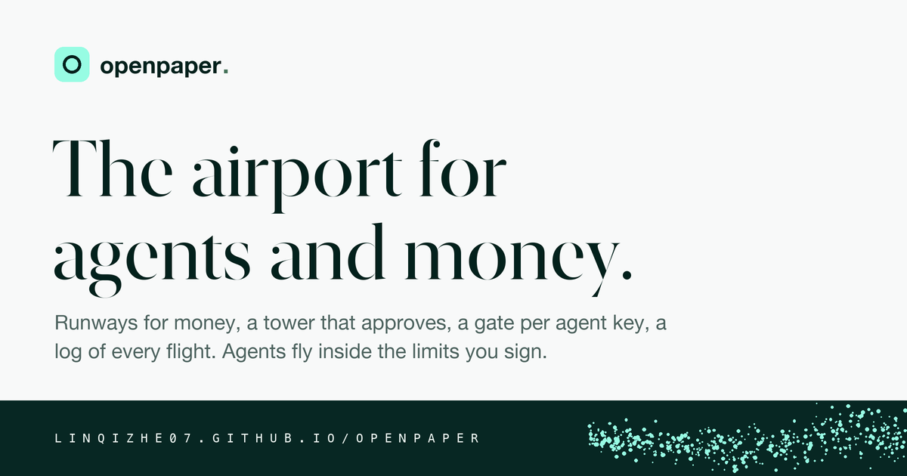
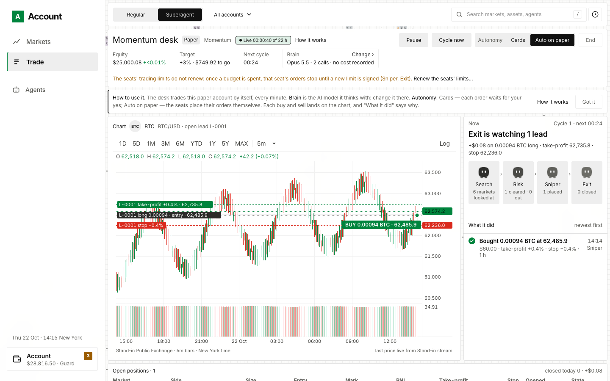

<p align="center"></p>
<p align="center"><a href="../README.md">English</a> · <b>中文</b></p>

# openpaper

**你的交易账户在一页上，AI agent 只在你签过名的额度里交易。**

openpaper 在你自己的电脑上跑。它把你的交易所、券商、钱包和预测市场账户放在一页上，给你一个用真实行情的纸上账户，让 AI agent——它自己的交易桌 Desk，或你通过 MCP 带进来的——在你签的额度里交易、挪钱、付款。中间没有服务器，不用注册，没有埋点：你的电脑自己读公开行情、直接和场所说话。网站：[linqizhe07.github.io/openpaper](https://linqizhe07.github.io/openpaper/)

- **你的账户在一页上**：93 家交易所（API 钥匙）、Alpaca、Robinhood、Kalshi、Polymarket、Hyperliquid、MetaMask 等钱包——持仓、订单、仓位、净值曲线，和一份可筛选、可导出的对账单。
- **用真实行情的纸上账户**：币、美股、永续和事件合约；市价、限价、止损、止损限价、追踪止损，开仓带止盈止损，美股时段，永续的资金费和强平；TWAP、VWAP、iceberg 分片执行，每单带交易成本分析。
- **交易终端**：你的网络能读到的每个市场——几年历史的 K 线、场所流推的盘口和成交、自己的入场、止损和挂单画在图上；★ 关注，🔔 提醒；一条命令行（⌘K：`AAPL DES`、`BTC GP`、`TOP`、`ECO`、`OMON`、`RISK`、`HELP`）。
- **新闻、日历、世界、期权、分析**：出版方自己的标题；Nasdaq 的日历、个股页和筛选器；股指、美债收益率曲线、外汇和商品；Cboe 和 Deribit 的期权链；几个市场放在一起比、算相关和 beta；自己持仓的敞口、波动率、VaR 和回撤；一屏自己拼的 Monitor。都是对场所自己的数做算术，不预测。
- **世界市场的永续**：Hyperliquid HIP-3 上按股票、指数、商品、外汇和利率部署的合约，有 K 线、能在纸上交易。
- **Superagent**：一桌 AI agent 自己在纸上账户上交易，动手前先读当天的标题和经济数据，回答你的 `ASK`，每一步实时放出来——用十三家模型 API 任何一家的钥匙，或你机器上跑的模型。
- **你自己的 agent（MCP）**：四十九个工具：读、交易、挪钱、付款、生息、提问、记忆，每个都在你为那个席位签的额度里。
- **要紧的都由你签**：每一笔订单、挪动和额度都由浏览器里一把导不出来的钥匙签；Guard 把每个请求留给你点头，Beast 让 agent 在额度里直接做；每笔有上限；哈希链账本记下一切。

## 目录

- [页面](#页面)
- [五分钟跑起来](#五分钟跑起来)
- [接你真实的账户](#接你真实的账户)
- [一切由你签](#一切由你签)
- [诚实边界](#诚实边界)
- [你的网络决定你看到什么](#你的网络决定你看到什么)
- [带你自己的 agent 进来](#带你自己的-agent-进来)
- [常驻后台](#常驻后台)
- [不联网看一圈](#不联网看一圈)
- [选项和环境变量](#选项和环境变量)
- [代码结构](#代码结构)
- [技术栈](#技术栈)
- [开发与测试](#开发与测试)
- [为什么金融需要一个开放网络](#为什么金融需要一个开放网络)
- [更多](#更多)
- [许可](#许可)

## 页面

<p align="center"></p>

替身账户上的 Trade → Superagent：Desk 开始四十秒，第一笔买入和它的止盈、止损画在 K 线上。真账户长得一样，换成你的场所和一把模型钥匙。

## 五分钟跑起来

[Node.js](https://nodejs.org) 22 或更新，和 Git。macOS 上测过；Linux 应该一样；Windows 没测。

```bash
git clone https://github.com/linqizhe07/openpaper.git
cd openpaper
npm ci
npm run account
```

打开 **http://127.0.0.1:4820**，输入终端打印的配对码：这个浏览器就是 owner，每一笔动钱的事都由它签。`npm run account -- --help` 列出全部选项。

1. **开一个纸上账户**：$10,000 纸上的钱，真实的公开行情。
2. **Trade**：在纸上买卖币、美股、永续和事件合约。
3. **Superagent**（Trade → Superagent）：粘一把 API 钥匙，按 **Start the superagent**。Anthropic、OpenAI、DeepSeek、Gemini、xAI、Kimi、Qwen、OpenRouter、Groq、Together、Meta 任何一家的钥匙，或你机器上的 Ollama / vLLM，不要钥匙；调用算在你的钥匙上。
4. **Markets**：★ 关注，🔔 提醒，⌘K 或 `/` 是命令行。美股的 **Financials** 来自它在 SEC 的申报，SEC 要求每个读者报上自己是谁：起账户时把 `SEC_CONTACT` 设成你的邮箱。
5. **Backtest**：一个策略在录下的 K 线上按同一个纸上账户的规则跑，每一次都计数、Sharpe 按之前试过的次数 deflate，最近 90 天留出。

## 接你真实的账户

**Account → Venues → Connect an account**：93 家交易所用 API 钥匙（Coinbase、Kraken、OKX、Binance 等）、Alpaca 和 Robinhood、Kalshi 和 Polymarket、Hyperliquid、MetaMask 等钱包。钥匙放在 `~/.openpaper/` 下的文件里，不经过页面和日志；页面上粘的 AI 钥匙存在同一个文件夹。真钱交易默认开着，每笔订单和挪动上限 $100，除非起的时候给 `--live-cap`；`--read-only` 关掉交易。

## 一切由你签

- **要紧的都由你签**：订单、挪动和每个 agent 的额度都由浏览器的钥匙签，账户逐一验签。
- **Guard 或 Beast**：Guard 下 agent 要做的每件事出一张卡等你点头；Beast 下 agent 直接做，只在你签的额度里。
- **每笔有上限**：起服务时的 `--live-cap`，默认 $100；在 Settings 里签一个别的数，重启照签的恢复。钱只去证明是你自己的地方。
- **什么都记着**：你电脑上一本哈希链账本，和一份可筛选、可导出的对账单。

## 诚实边界

做这个东西从没用过一把真钥匙、一个真钱包。真实连接和真钱写入只对着替身测过：替身交易所、替身链、用完即扔的测试钱包，和不带钥匙读场所的公开接口。纸上账户、行情、agent 和签名从头到尾跑过；在真场所落下的最后一步没有。所以先用只读钥匙；要写，先用小上限、小金额，在页面上读过场所自己的回答，再信下一笔。

钥匙文件只有你能读（0600），页面从不见它们的值，但以你的身份跑的任何程序都读得到。owner 的钥匙在你的浏览器里、导不出来；浏览器的存储被清了，`npm run account -- --fresh` 从零开始。

## 你的网络决定你看到什么

中间没有服务器，所以你的网络——国家、IP、公司防火墙——决定哪些场所答你。账户从你的网络问每一家，只画答你的；拒绝的标 *Not served here*，有地区版的（Binance.US、OKX US、Polymarket US）写在旁边。从不绕过封锁；为了把场所公布的规则对上你的网络，它问一个公开的位置检查（Polymarket 的、Cloudflare 的或 ipapi.co 的）。`npm run account:check` 打印你的网络能接到什么，每家用自己的话，里面没有 IP、地点和钥匙。

| 什么 | 从哪读 | 多新 |
|---|---|---|
| 币 | 接上的场所自己的流；否则 Kraken、Coinbase、OKX、Binance、Bybit 和 Hyperliquid | 实时 |
| 美股和 ETF | Robinhood 或 Nasdaq 实时；Cboe 的 15 分钟延迟报价排最后、标明 | 约 15 秒一次；纸上订单只在它的时段里成交 |
| 永续 | Hyperliquid：它自己的合约，和它 HIP-3 dex 上的 | 实时；每小时资金费，按维持保证金强平 |
| 事件合约 | Kalshi、Polymarket、Polymarket US | 实时；结算时按 $1 或 $0 结 |
| Pre-IPO 和 RWA | 九家；Robinhood Stock Tokens、Gate 的 xStocks、Ondo | 每次读 |
| 财务 | SEC EDGAR | 留 12 小时 |
| 新闻 | 出版方自己的源：美联储、欧央行、SEC、CNBC、MarketWatch、华尔街日报、BBC、Nasdaq、CoinDesk、Cointelegraph、The Block、Decrypt、PR Newswire | 留 5 分钟 |
| 日历 | Nasdaq：经济数据、财报、股息、拆股、IPO | 留 15 分钟 |
| 股指 | Cboe：标普 500、纳斯达克 100、道琼斯、罗素 2000、VIX 等 | 晚 15 分钟 |
| 收益率曲线 | 美国财政部的 par 曲线，带 2s10s、3m10y、5s30s 利差 | 收盘后一天一次 |
| 外汇 | Kraken 九对；其余二十对是 ECB 的欧元参考汇率 | 实时；ECB 的是当天定盘价 |
| 商品 | Hyperliquid xyz 永续的预言机价 | 实时 |
| 期权 | Cboe（美股和它的指数）；Deribit（BTC、ETH） | 晚 15 分钟；Deribit 实时 |
| 一只股票的页、筛选器 | Nasdaq 自己的页面 | 留 5 分钟 |

没有源答的市场就没有价：纸上的市价单被拒、限价单等着，页上说明原因。

## 带你自己的 agent 进来

按 **Copy setup command**（Portfolio → Get started，或 Agents 下），在你的 agent 那边跑：Claude Code 或任何 MCP 客户端。在页面上放它进来、给它一个额度；它读你的账户，在额度里交易、挪钱、付款。

## 常驻后台

```bash
npm run account:service -- install --live-cap 20
```

macOS 上：登录就起、停了就重启。还有 `status`、`restart`、`logs`、`code`（配对码）、`uninstall`。Linux 用你自己的服务管理器跑 `npm run account`。

## 不联网看一圈

```bash
npx tsx test/standin/ui-standin.ts --port 4821 --superagent
```

同一个页面，场所是替身，在 http://127.0.0.1:4821：不联网、不动钱、不要钥匙，Desk 用脚本交易。

## 选项和环境变量

`npm run account -- …`：

| 选项 | 做什么 | 默认 |
|---|---|---|
| `--port <number>` | 端口，只听 127.0.0.1 | 4820 |
| `--home <dir>` | home 目录：账本、钥匙文件、纸上账本、席位 | `$OPENPAPER_HOME`，否则 `~/.openpaper` |
| `--live-cap <dollars>` | 一笔订单或挪动最多值多少；Settings 里可以签别的数 | 100 |
| `--read-only` | 不下单、不动钱 | 关 |
| `--fresh` | 从零开始 | 关 |
| `--classic` | 原来的模拟对账单，没有账户层 | 关 |

`npm run account:check` 收 `--keys`、`--home <dir>` 和 `--json`；`npm run account:service` 收 `install`（后面跟服务器的选项）、`status`、`restart`、`logs`、`code`、`uninstall`。

`--help` 列出全部环境变量。进后台服务的只有 `OPENPAPER_HOME`、`SEC_CONTACT`、`PORTFOLIO_RPC_*` 和 MetaMask 的开关；模型钥匙放钥匙文件，不放 shell。

## 代码结构

```
src/portfolio/         账户：server.ts（接口）、service.ts、router.ts
  account/             签名的门、状态、恢复、Desk 和它的脑子、日历、对账单
  live/                真实场所和公开行情
  public/              页面：account.html 和 ui/*.js，不用构建
  backtest/            录下的 K 线、引擎、策略、Desk 回测、实验室的留出期和试验台账
  mcp.ts               agent 席位跑的 MCP 服务（49 个工具）
  account-service.ts · account-check.ts · home.ts
  adapters/, venues.ts 模拟场所，只给 --classic 和测试
src/core/ src/agent/   哈希链账本、拒绝码、哈希、jsonl
src/runner/ src/plugins/ src/venues/ src/contract/ src/control-room/ src/wallet/
                       更早的演示（docs/earlier-demos.md）
fixtures/home/         账户起步的 fixtures
test/                  unit/ · attack/ · standin/ · e2e
site/ scripts/         公开介绍页，和算它的数字的脚本
docs/ COOKBOOK.md      导览、每件事怎么做、每一部分怎么做出来的
```

## 技术栈

Node 22、TypeScript（strict）、Express、ccxt、viem、zod、MCP SDK、vitest。页面是纯 HTML、CSS 和 JavaScript 当文件发：没有框架、不用构建，字体自己托管。

## 开发与测试

Node 22 或更新、Git、`npm ci`：不用构建、没有数据库。改 `src/portfolio/public/` 下的东西刷新就见；改服务端重启就见。CI 在每次 push 和 PR 上跑类型检查和整套测试；测试钉死的约定在 [CONTRIBUTING.md](../CONTRIBUTING.md)。

| 命令 | 做什么 |
|---|---|
| `npm run account` | 账户，在 http://127.0.0.1:4820 |
| `npm run account:check` | 你的网络能接到什么；可以直接贴给别人 |
| `npm run account:service -- <command>` | macOS 上把账户装成后台服务 |
| `npm run account:replay -- --day 2026-10-01` | 录下的 Hyperliquid 一天（tardis.dev）在纸上账户上让 Desk 回放一遍 |
| `npm run account:backtest -- --markets perp:BTC,perp:ETH` | 一个策略在录下的 K 线上按纸上账户的规则跑，旁边是买入持有：每一次进哈希链的试验台账、deflate 下一次的 Sharpe，最近 90 天留出；`--grid fast=10,20 --folds 4` walk-forward，`--strategy desk` 跑账户自己的 Desk，`--rule` 让它守一条教训 |
| `npm run account:demo` | 账户的十四个 beat，无头跑 |
| `npm run typecheck` | `tsc --noEmit`，strict；vitest 不做类型检查，提交前先跑它 |
| `npm test` | 整套：约 210 个文件、3,300 个用例，串行。`npx vitest run test/unit/live-paper.test.ts` 跑一个文件，`-t "几个字"` 跑一个用例 |
| `npm run site` · `npm run site:numbers` | 本地预览公开介绍页；新增测试文件后重算它的数字 |
| `npm run demo` · `npm run control-room` · `npm run wallet` | 更早的演示（[earlier-demos.md](earlier-demos.md)） |

## 为什么金融需要一个开放网络

金融基础设施要规模：撮合、风控、结算，尤其是流动性，越集中越好。金融创新要的相反：它来自人，没有一家公司雇得下所有人。连接服务不等于共享基础设施；值得建的是执行、流动性和它们之上的能力——现货、永续、股票、策略——各建一次、大家共用，每个应用保留自己的品牌、产品和用户。共用的部分不会把产品做成一样，就像共用的云没有把互联网做成一样；AI 则让一个有策略、不会编程的人也能把它做成产品。护城河是参与者之间的经济关系，不是某一项技术。金融该由所有人为所有人建。

按 GeorgeAZ 的[《为什么金融的未来需要一个开放网络？》](https://x.com/georgemadcrypto/status/2120357478693298491)精简。

## 更多

- 第二个账户：`npm run account -- --port 4825 --home ~/openpaper-second`。
- 再往下读：[导览](tour.zh.md)、[COOKBOOK](../COOKBOOK.md)、[account.md](account.md)、[earlier-demos.md](earlier-demos.md)。
- [CHANGELOG.md](../CHANGELOG.md)：每个合并的 PR 一行。Settings → Version 和 `GET /api/now` 说你跑的是哪个版本。
- 问题和 bug：[GitHub issues](https://github.com/linqizhe07/openpaper/issues)。

## 许可

Apache-2.0：见 [LICENSE](../LICENSE)。版权 2026 Linqi Zhe。要贡献先读 [CONTRIBUTING.md](../CONTRIBUTING.md)；安全问题按 [SECURITY.md](../SECURITY.md) 私下报。

openpaper 不是投资建议。真钱交易风险自负；纸上的钱不是钱。
